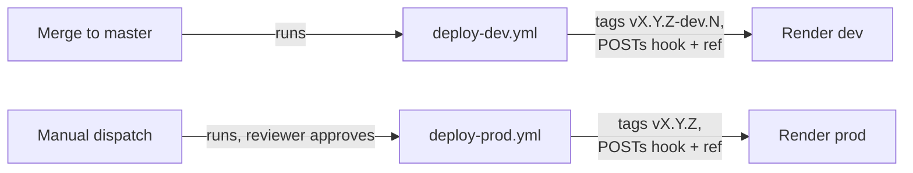

# DevOps (pykaraoke)

Small private app. Priorities in order: **reproducible**, **cheap**, **easy to hand to future
you**. No Kubernetes, no Terraform.

## Toolchain

| Concern              | Tool                     | Why                                                |
|----------------------|--------------------------|----------------------------------------------------|
| Python + deps + venv | `uv`                     | One tool, `uv.lock` committed, fast CI cache       |
| Lint/format          | `ruff`                   | Replaces Black + Flake8 + isort                    |
| Task runner          | `make`                   | Already on every machine; self-documenting targets |
| Local services       | `docker compose`         | Postgres 17 + mailpit, disposable                  |
| Image                | multi-stage `Dockerfile` | Render builds it from the repo; same file locally  |

## Environment variables

Twelve-factor: **config comes from the environment, never from a committed file.**

| Variable               | Local default            | Notes                                           |
|------------------------|--------------------------|-------------------------------------------------|
| `DJANGO_SECRET_KEY`    | dev-only value in `.env` | Real value is a deploy secret. Never committed. |
| `DJANGO_ALLOWED_HOSTS` | `localhost,127.0.0.1`    | Comma-separated. First entry is the health Host |
| `DATABASE_URL`         | `sqlite:///db.sqlite3`   | `postgres://...` when compose is up             |
| `EMAIL_URL`            | `smtp://localhost:1025`  | mailpit locally, real SMTP in prod              |
| `ENABLE_API_DOCS`      | on in dev, off elsewhere | Serves `/api/schema/`, `/api/docs/`. Unset in prod |
| `CSRF_TRUSTED_ORIGINS` | empty                    | Comma-separated, scheme included. Set in prod   |

There is no `DJANGO_DEBUG`: `settings/dev.py` hardcodes `DEBUG = True` and `prod.py` `False`.

`.env` is gitignored. `.env.example` is committed and lists every key with a safe placeholder.
When you add a variable, add it to `.env.example` **in the same change**, or the next person
gets a `ImproperlyConfigured` on a fresh clone.

`.claude/settings.json` denies reading `.env`, so Claude never sees real values.

## Local services

```yaml
services:
  postgres:
    image: postgres:17-alpine
    healthcheck:
      test: ["CMD-SHELL", "pg_isready -U pykaraoke"]
    volumes: ["pgdata:/var/lib/postgresql/data"]
  mailpit:
    image: axllent/mailpit
    ports: ["1025:1025", "8025:8025"]
```

- Postgres 17 because Django 6.1 requires PostgreSQL 15+.
- **Named volume**, not a bind mount. A bind mount on macOS is slow and permission-cursed.
- mailpit catches the confirmation emails and shows them at `http://localhost:8025`. No real mail
  is ever sent in development.
- `make db-up` / `make db-down`. Data survives `down`; `docker compose down -v` wipes it.

Docker is optional: `DATABASE_URL=sqlite:///db.sqlite3` runs the whole app with no daemon. Use
Postgres before shipping anything that relies on constraints or migrations behaving identically.

## Dockerfile shape

Two stages in `Dockerfile`: a uv builder (`uv sync --locked --no-dev --no-install-project`), then
a `python:3.13-slim-bookworm` runtime that gets only the built `.venv`.

| Piece | Why | What breaks if it changes |
|---|---|---|
| Multi-stage | Build tools never reach the runtime image | Image grows, attack surface grows |
| `pyproject.toml` + `uv.lock` copied before source | A code change keeps the dependency layer | Every build reinstalls everything |
| `--no-dev` | pytest and ruff have no place in production | Dev tools ship |
| `collectstatic` at build, placeholder secret | Settings need a key to load, not a real one | Real key in a layer, or no static files |
| `chown app:app /app` | The SQLite file lives next to `manage.py` | `migrate` fails: read-only database |
| Non-root `USER app` | A container running as root is a finding | Root in prod |
| `HEALTHCHECK` on `/health/` | Host header is the first `DJANGO_ALLOWED_HOSTS` entry | Unknown Host gets 400, probe fails |
| `ENTRYPOINT docker-entrypoint.sh` | `migrate --noinput`, then gunicorn on `${PORT:-8000}` | Render free has no pre-deploy command |

`GET /health/` returns `{"status": "ok"}` with no DB and no auth. It stays plain-HTTP reachable
(`SECURE_REDIRECT_EXEMPT` in `prod.py`).

## Deploy flow (Render)

CI builds no image. Render builds the Dockerfile from the repo on each deploy-hook call.



- Hooks live in GitHub secrets `RENDER_DEPLOY_HOOK_DEV` and `RENDER_DEPLOY_HOOK_PROD`.
- **Auto-Deploy is OFF on both Render services**, or every push builds untagged, twice.
- Free plan: spins down after 15 min idle; the disk is ephemeral, so SQLite resets on each deploy
  (accepted for now).
- Tags come from `.github/scripts/next-version.sh`. Details in `docs/CI-CD.md`.

Production checklist:
- [ ] Real `DJANGO_SECRET_KEY` and `DJANGO_ALLOWED_HOSTS` in Render env vars
- [ ] `ENABLE_API_DOCS` unset or `False`
- [ ] `CSRF_TRUSTED_ORIGINS` set to the real origin, scheme included
- [ ] Auto-Deploy off on both Render services
- [ ] Required reviewer set on the GitHub `production` environment
- [ ] `python manage.py check --deploy` clean
- [ ] Managed Postgres with automated backups, before real data (SQLite resets on deploy)
- [ ] The data-purge job scheduled (see `docs/SECURITY.md`)

## See also

- Pipeline YAML conventions: skill `github-actions`
- Data retention and secrets policy: `docs/SECURITY.md`
- Setup steps for a fresh machine: `docs/SETUP.md`
