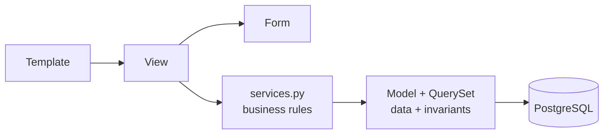

# Layers and Python (pykaraoke)

*Where code belongs, and how to write it. Part of the `django-mtv` skill.*

Clean architecture for a small MTV app first, then the Python conventions the Ruff config enforces.
The core Django patterns are in `SKILL.md`.


## Clean architecture, Django-sized (pykaraoke)

This is a small MTV app for a private karaoke night. Full hexagonal architecture would cost more
than it returns here. The rule is **one thin service layer, and nothing else**. The decision and
its reasons are in `docs/ARCHITECTURE.md`. Current files: `karaoke/services.py`,
`karaoke/exceptions.py`, `karaoke/managers.py`, all still stubs until Milestone 2.

### The layers



Dependencies point right. A model never imports a view. `services.py` never imports
`HttpRequest`.

### Where does it go?

| The logic is... | It belongs in | Example |
|---|---|---|
| A fact about **one** object | model method or property | `event.is_open` |
| A **reusable query** | custom QuerySet method | `Participant.objects.confirmed()` |
| A **database invariant** | `Meta.constraints` | one pseudo per event |
| **Shape** of user input | form `clean_*` | pseudo ≥ 2 chars |
| A **rule spanning objects**, or a state change with side effects | `services.py` | `reserve_seat()` promotes from the waiting list and sends the confirmation |
| **HTTP** concerns: status, redirect, messages, session | view | POST/Redirect/GET |
| **Presentation** | template / template tag | date formatting |

Fast test: *could this rule be true in a CLI command with no browser?* If yes → service or model.
If no → view.

### The service layer

```python
# karaoke/services.py
def reserve_seat(event: KaraokeEvent, pseudo: str, full_name: str) -> Participant:
    """Reserve a seat, or join the waiting list when the event is full."""
    if not event.is_open:
        raise EventClosedError(event.pk)

    status = Participant.Status.CONFIRMED if event.seats_left > 0 else Participant.Status.WAITING
    participant = Participant.objects.create(
        event=event, pseudo=pseudo, full_name=full_name, status=status
    )
    notifications.send_confirmation(participant)
    return participant
```

Rules for `services.py`:
- Takes and returns **domain objects**, never `request`, never `QueryDict`, never `form`.
- Raises domain exceptions (`KaraokeError` subclasses, see the Errors section below). Never returns
  `None` to mean failure.
- Wraps multi-write operations in `transaction.atomic()`.
- Is the **only** place the view calls for a state change.

### When NOT to abstract

The strongest signal that this project is being over-engineered:

- ❌ A `repositories.py` wrapping the ORM. Django's ORM **is** the repository.
- ❌ A `UseCase` class with a single `execute()` method. That is a function with extra steps.
- ❌ Interfaces / ABCs with exactly one implementation.
- ❌ DTOs mirroring models field-for-field.
- ❌ A `domain/` package separate from `models.py` in an app this size.

Rule of three: extract on the **third** repetition, not the first. Two similar blocks are a
coincidence; three are a pattern.

### When a view gets long

Diagnose before refactoring:

1. Is it doing more than one HTTP thing? → split into two views/URLs.
2. Is it computing something for the template? → model property or context helper.
3. Is it applying a business rule? → move to `services.py`.
4. Is it just a long form + render? → that is fine, leave it.

### Migration path (documented, not built)

If this app ever grows past ~15 models or gains a second delivery channel (an API, a bot), the
next step is one package per bounded context (`events/`, `songs/`). Still Django apps, still
this same service layer. Do not pre-build it.

---


## Python standards (pykaraoke)

Python 3.13+. Ruff is the only linter/formatter. No Black, no Flake8, no isort.

### Non-negotiables

1. **Type hints on every function signature.** Never `Any`. Use `X | None`, not `Optional[X]`.
2. **Early return over nesting.** Max 2 levels of indentation inside a function body.
3. **No bare `except:`** and no `except Exception` without re-raising or logging.
4. **f-strings** for interpolation. Never `%` or `.format()`.
5. **No mutable default arguments.** Ruff `B006` catches it.

### Shape of a function

```python
def get_event_title(event_id: int) -> str:
    event = KaraokeEvent.objects.filter(pk=event_id).first()
    if event is None:
        raise KaraokeError(f"Event {event_id} does not exist.")

    return event.title
```

Read it top to bottom: guard clauses first, happy path last, one return type.

### Naming

| Thing    | Convention               | Example                |
|----------|--------------------------|------------------------|
| Module   | `snake_case`, singular   | `services.py`          |
| Class    | `PascalCase`             | `SongRequest`          |
| Function | `snake_case`, verb first | `cancel_reservation`   |
| Boolean  | `is_` / `has_` / `can_`  | `is_open`, `has_seat`  |
| Constant | `UPPER_SNAKE`            | `MAX_SONGS_PER_PERSON` |
| Private  | leading `_`              | `_build_token`         |

Never abbreviate: `participant`, not `part`. Never `data`, `info`, `obj`, `tmp` as a name.

### Errors

Domain failures get their own exception class in the app's `exceptions.py`:

```python
class KaraokeError(Exception):
    """Base for every domain failure in this app."""


class EventClosedError(KaraokeError):
    def __init__(self, event_id: int) -> None:
        super().__init__(f"Event {event_id} is closed for sign-ups.")
        self.event_id = event_id
```

Views catch `KaraokeError` and turn it into a message + redirect. Services raise, never
return `None` to signal failure. Never `return False` as an error channel.

### Ruff rule families enabled, and why

| Code     | Family                 | Why it's on                                                       |
|----------|------------------------|-------------------------------------------------------------------|
| `E`, `F` | pycodestyle / Pyflakes | Baseline correctness: undefined names, unused imports             |
| `I`      | isort                  | Import ordering, replaces the isort tool                          |
| `UP`     | pyupgrade              | Keeps syntax modern for the target Python                         |
| `B`      | bugbear                | Mutable defaults, loop-variable capture, silent `except`          |
| `S`      | bandit-in-ruff         | Catches `assert` in prod code, weak hashes, hardcoded secrets     |
| `DJ`     | flake8-django          | `null=True` on `CharField`, missing `__str__`, `Model.Meta` order |
| `C4`     | comprehensions         | `list(x for ...)` → `[x for ...]`                                 |
| `SIM`    | simplify               | Collapses redundant `if`/`else`, nested `with`                    |

Per-file ignores: `tests/**` drops `S101` (asserts are the point) and `**/migrations/**` is
excluded entirely (generated code).

### When Ruff and readability disagree

Ruff wins on style. If a rule is genuinely wrong for a line, add a scoped
`# noqa: <CODE>  # reason` on that line. Never a file-level or blanket `# noqa`. A `noqa`
without a reason comment is a review blocker.

### Docstrings and comments

One-line docstring on anything non-obvious: every service function, every model method, every
custom manager. Skip them on views whose name and template already say everything. Explain
**why**, not what the code already shows. Comments follow the same rule: rare, one line, only
when the *why* is not visible in the code (see `docs-writing`, "Sentences").
