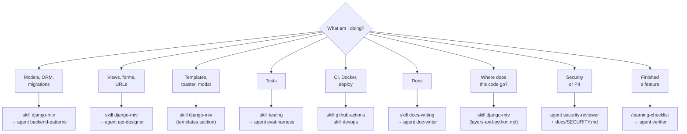
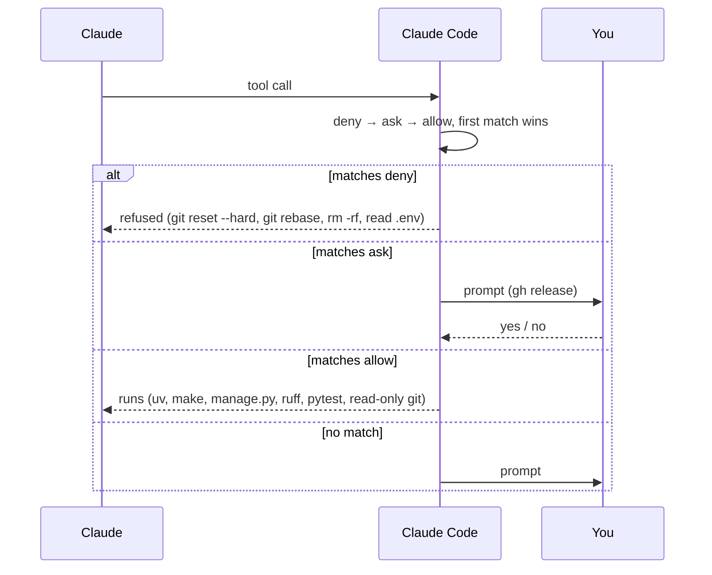

# AI workflow

*How Claude Code is set up in this repo, and how to work with it.*

Everything lives in `.claude/`. Three surfaces, one rule set.

## The three surfaces

| Surface   | What it is                                                   | Where                            | Loaded                                                         |
|-----------|--------------------------------------------------------------|----------------------------------|----------------------------------------------------------------|
| **Skill** | Reusable knowledge: this project's conventions for a topic   | `.claude/skills/<name>/SKILL.md` | On demand, into the main conversation                          |
| **Agent** | A worker with its own fresh context and a restricted toolset | `.claude/agents/<name>.md`       | When delegated to; its output comes back, its context does not |
| **Rule**  | Enforced by the harness, not by the model                    | `.claude/settings.json`          | Always                                                         |

The difference that matters: a **skill** changes how Claude works. An **agent** does a job
somewhere else and reports back. Use one when the job would flood the conversation with files.
A **rule** is the only one the model cannot talk its way past.

## The feature loop

```mermaid
flowchart TD
  A[Issue: status:ready,<br/>current milestone] --> B[/karaoke-issue-launch/]
  B --> C[agent issue-orchestrator<br/>gate, branch, draft PR]
  C --> D[You validate the<br/>Tests checklist]
  D --> E[Implement, tests first<br/>tick Requirements as they land]
  E --> F[agent verifier<br/>lint, tests, conventions]
  F -->|red| E
  F -->|green| G{Touches auth<br/>or personal data?}
  G -->|yes| H[agent security-reviewer]
  G -->|no| I
  H --> I[/learning-checklist/<br/>+ owning doc + CHANGELOG]
  I --> J[/commit-push-pr/<br/>orchestrator marks PR ready]
```

Step `D` is the plan review: no code exists until you have read the Tests checklist in the draft
PR. Commit, push and `gh pr ready` are allowed; merging asks first. The merge is always yours.

## Which surface do I reach for?



Unsure whether a library behaves the way you remember? **agent `doc-lookup`** cites the
version-pinned page instead of guessing.

## Skills

| Skill                | Use it for                                                           |
|----------------------|----------------------------------------------------------------------|
| `django-mtv`         | Models, QuerySets, forms, views, URLs, N+1, where logic belongs, Python style, Ruff |
| `testing`            | pytest-django, factories, what is worth testing, coverage            |
| `github-actions`     | Workflow anatomy, uv caching, service containers, environments       |
| `devops`             | uv, Makefile, Docker, env vars, Postgres, deploy skeleton            |
| `docs-writing`       | Doc structure, mermaid rules, doc ownership, sentence style          |
| `learning-checklist` | `/learning-checklist`, the retention step at the end of a feature    |

## Agents

| Agent               | Job                                                   | Model  |
|---------------------|-------------------------------------------------------|--------|
| `doc-writer`        | Writes/updates docs in house style                    | sonnet |
| `doc-lookup`        | Finds the authoritative answer, cites it              | haiku  |
| `verifier`          | Runs the checks, reviews code against conventions, reports real output | sonnet |
| `api-designer`      | Designs routes and form contracts, updates `API.md`   | sonnet |
| `eval-harness`      | Designs and runs a feature's test suite, reports gaps | sonnet |
| `backend-patterns`  | Models, queries, migrations, services review          | sonnet |
| `security-reviewer` | Django security, OWASP basics, PII policy             | opus   |
| `issue-orchestrator`| Gates readiness, opens the draft PR, owns issue and PR state | sonnet |

Read-only reviewers run in plan mode. They cannot edit. `doc-writer`, `api-designer` and
`eval-harness` keep project memory, so conventions accumulate across sessions.
`issue-orchestrator` has `Bash` and `Read` only: it changes issue and PR state, never code.

## Rules

`.claude/settings.json` is committed, so the rules apply to everyone who clones the repo.



| Rule                                                                   | Why                                                  |
|------------------------------------------------------------------------|------------------------------------------------------|
| **deny** `git reset --hard`, `git rebase`                              | History loss is unrecoverable from inside a session. |
| **deny** `rm -rf`                                                      | Same.                                                |
| **deny** `Read(./.env*)`                                               | Claude never sees real secrets.                      |
| **ask** `gh release`                                                   | Outward-facing. You confirm each one.                |
| **ask** `gh pr merge`                                                  | Outward-facing and irreversible in practice.         |
| **allow** `git commit`, `git push`, `gh pr`, `gh label`                | Lets Claude open the draft PR and mark it ready.     |
| **allow** `uv`, `make`, `manage.py`, `ruff`, `pytest`, read-only `git` | Project-scoped, reversible, runs unattended.         |

A `PostToolUse` hook runs `ruff format` + `ruff check --fix` on every Python file Claude edits, so
formatting never reaches review. It no-ops silently when `uv` or `pyproject.toml` is missing.

## Adding a skill or an agent

1. **Skill** → `.claude/skills/<name>/SKILL.md`; **agent** → `.claude/agents/<name>.md`.
2. Frontmatter: `name` + `description`. The description is a **trigger**, not a summary. Lead
   with the phrases you would actually type ("when creating a model", "when CI is red"). Under
   1536 characters.
3. **Hard cap: 200 lines.** A skill nobody reads to the end is a skill that does not work. Move
   depth into a sibling file and link to it.
4. Project-specific beats generic. "Use `select_related` for forward FKs" is worth writing;
   "Django is a web framework" is not.
5. Agents get a `tools` allowlist. Reviewers get `permissionMode: plan`.
6. Register it in [`CLAUDE.md`](../CLAUDE.md) and in the tables above. An unregistered skill is
   one Claude will not find.

Verify with `claude doctor`, then `/skills` and `/agents`.

## Issues, labels and draft PRs

The issue is the spec, the draft PR is the plan, and the code comes last. The templates in
`.github/ISSUE_TEMPLATE/` and `.github/pull_request_template.md` hold the shape of each.

**Type** (one per issue): `task`, `enhancement`, `bug`.

**Status** (one at a time, replaces status words in titles and bodies): `status:ready`,
`status:in-progress`, `status:cancelled`.

**Area** (any number, by design-system concern): `ci-cd`, `security`, `authentication`,
`database`, `architecture`, `testing`, `i18n`, `ui-ux`, `devops`, `performance`. Plus the existing
`accessibility` and `documentation`. `gh issue list --label security` answers "what is open about
security".

**Milestone**: the native GitHub milestone. The current one has `current` in its title, moved by
hand.

Rule, in order:

1. Write the issue from the template. Requirements, design and open questions go in it.
2. Set `status:ready` when the spec is agreed. Only you set it.
3. `/karaoke-issue-launch` hands the issue to `issue-orchestrator`. It refuses unless the issue
   is open, `status:ready` and in the milestone titled `current`. Then it branches
   (`type/N-slug`), makes an empty commit, pushes, opens a **draft PR** filled from the issue,
   and sets `status:in-progress`.
4. Read the Tests checklist in the draft PR and validate it. No code before that.
5. Write the tests first, then the code. The orchestrator ticks Requirements and Tests as they
   land.
6. `/commit-push-pr` commits, pushes, and the orchestrator marks the draft ready once every box
   is ticked and `make check` is green.

The orchestrator is the only thing that changes labels, draft state or checkboxes. Commands and
other agents read them.

Old issues (#1 to #11) keep their original format. They are not relabelled.

## Anti-patterns

- **Skipping plan mode on anything non-trivial.** Agreeing on the approach costs one message;
  undoing the wrong approach costs an afternoon.
- **Delegating to an agent what a skill would fix.** An agent starts cold and re-derives context
  you already have.
- **Letting docs drift.** The doc-ownership table in the `docs-writing` skill says which file owns
  which change; update it in the same commit.
- **Shipping without the learning checklist.** The point of this project is what you retain, not
  what you deploy.

## See also

- Index of everything: [`CLAUDE.md`](../CLAUDE.md)
- What gets built when: [EPICS.md](EPICS.md)
- Retention checklists: [learning/README.md](learning/README.md)
