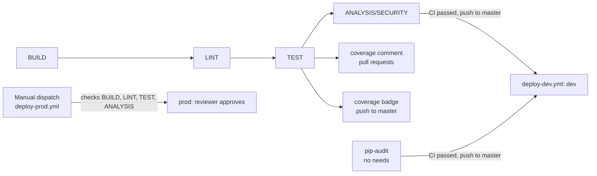

# CI/CD

*Four GitHub Actions workflows: `ci.yml` checks the code, and three deploy workflows ship it. What
each step does, and what this pipeline does not do yet.*

## Pipeline overview

Two tag lines, one script. Dev deploys tag `vX.Y.(Z+1)-dev.N`; prod deploys tag `vX.Y.Z`.

| Workflow | Trigger | What it does | Environment | Hook secret |
|---|---|---|---|---|
| `ci.yml` | pull request, push to `master`, weekly schedule | BUILD, LINT, TEST, ANALYSIS/SECURITY, pip-audit, coverage | none | none |
| `deploy-dev.yml` | `workflow_run` on CI, push to `master` only | tag the tested commit, call the dev hook | `development` | `RENDER_DEPLOY_HOOK_DEV` |
| `deploy-prod.yml` | manual (`workflow_dispatch`), `bump` input | check CI for the commit, tag, call the prod hook | `production` (reviewer) | `RENDER_DEPLOY_HOOK_PROD` |

Deploys never run on a pull request or the weekly schedule. Dev deploys only after CI passed on
the commit pushed to master. Prod deploys only when a person starts them, and CI must have passed
on that commit first. CI builds and pushes no image: Render builds the Docker image from the repo
on each deploy-hook call.

The pipeline runs Python 3.13 only, the version in the `Dockerfile`. Every `setup-uv` step pins it,
and `tests/test_ci_workflow.py` fails if one drifts.

## `ci.yml`

Triggers: pull requests, pushes to `master`, and a weekly schedule (Monday 06:00 UTC). A new CVE
needs no code change on this repo's side to matter, so pip-audit reruns regardless of activity.
Pull requests cancel the run they superseded; pushes to master always finish, since dev deploys
wait on them.

Each stage is one job, named after the stage. A failed stage stops the stages after it. pip-audit
has no `needs:`, so a red LINT or TEST cannot skip the weekly CVE scan.

### BUILD

1. **Checkout**: clones the repo at the triggering commit.
2. **Install uv** (`astral-sh/setup-uv@v10.1.0`). Installs `uv` itself and restores its dependency
   cache, keyed on `uv.lock`. `python-version: "3.13"` is pinned: unpinned, `uv` picks the newest
   CPython, and `psycopg-binary` has no wheel for 3.15, so `uv sync --locked` fails.
3. **Install dependencies**: `uv sync --locked`. `--locked` fails the job outright if `uv.lock`
   doesn't match `pyproject.toml`, rather than silently re-resolving.
4. **Collect static files**: `manage.py collectstatic --noinput` with `DJANGO_SETTINGS_MODULE=pykaraoke.settings.prod`
   and throwaway env vars. Catches a broken static pipeline before deploy. It does not check
   templates for missing `` references.

### LINT

Needs BUILD. Installs with `uv sync --locked --all-groups`.

1. **Cache pre-commit hook environments**: restores `~/.cache/pre-commit`, keyed on
   `.pre-commit-config.yaml`'s hash.
2. **Run pre-commit**: `uv run pre-commit run --all-files --show-diff-on-failure`. The same command
   and config the local git hook runs, so CI can never disagree with a local run. Not
   `pre-commit/action`, which would install its own pre-commit and bypass the version in `uv.lock`.

### TEST

Needs LINT. Permissions: `contents: read` only. This job runs project code and dependencies, so it
never holds a write token.

1. **Run tests**: `uv run pytest --cov --cov-report=xml --cov-report=html --cov-report=term`. No
   Postgres service container yet. See "What's missing" below.
2. **Upload coverage data**: artifact `coverage`, holding `.coverage`, `coverage.xml` and `htmlcov/`,
   kept 14 days. `include-hidden-files: true` is required, since `.coverage` is a dotfile and
   upload-artifact skips those by default. `if: always()` so a failing run still uploads the data.

### ANALYSIS/SECURITY

Needs TEST. Installs with `uv sync --locked --all-groups`.

1. **Bandit**: `uv run bandit -qr . -c pyproject.toml`. The `-c` is required, or bandit ignores
   `[tool.bandit]` entirely and crawls `.venv`'s thousands of files.
2. **Django deploy check**: `manage.py check --deploy --tag security --fail-level WARNING`, with
   `DJANGO_SETTINGS_MODULE=pykaraoke.settings.prod` and throwaway env vars (values that satisfy the
   checks' length and entropy rules, not real secrets). The settings module must be named
   explicitly: `manage.py` defaults to `settings.dev`, which has `DEBUG=True` and no HTTPS settings.
   Scoped to the `security` tag because nothing configures a real SMTP backend yet; the unscoped
   `--deploy` check would fail on `mail.E001` regardless of environment.

Both checks must pass before any deploy. A manual prod run can override only pip-audit.

### pip-audit

No `needs:`. Runs on every event, including the weekly schedule, so a red LINT or TEST never hides a
new CVE. Checks every locked dependency against known vulnerability databases. It is separate from
ANALYSIS so that a CVE with no fix yet can be overridden on a manual prod run without also
overriding bandit or the deploy check.

### coverage comment (pull requests)

Needs TEST, and runs only on pull requests. Permissions: `contents: read`, `pull-requests: write`.
It runs no project code. It downloads the `coverage` artifact, then runs
`py-cov-action/python-coverage-comment-action`, pinned to a commit SHA, to post or update a comment
with the diff against master. Checkout uses `persist-credentials: false`.

### coverage badge (push to master)

Needs TEST, and runs only on a push. Permissions: `contents: write`. This is the only job in
`ci.yml` with a write token. It runs no project code, only the coverage action, which saves the
total into the `python-coverage-comment-action-data` branch. That branch feeds the badge at the top
of the README. The badge appears after the first push to master, since that is when the branch is
created. Coverage paths are relative (`relative_files = true` in `pyproject.toml`), so the action can
match them.

## `deploy-dev.yml`

Triggers: `workflow_run` on the CI workflow, when it completes. The job runs only if CI
concluded `success` **and** the run was a `push` to `master`. A scheduled CI run on master also
has `head_branch: master`, so the `event` check keeps it from deploying.

Concurrency group `deploy-dev`, no `cancel-in-progress`: a half-cancelled deploy is worse than a
queued one, and queued merges each get their own tag.

1. **Checkout** with `ref: github.event.workflow_run.head_sha`, the commit CI tested, not whatever
   master points at by now. `fetch-depth: 0`: the tag script reads every existing tag, and without
   them it falls back to `0.0.0` and hands out `v0.0.1-dev.1` again.
2. **Compute next dev tag**: `.github/scripts/next-version.sh dev`. The output is assigned to a
   variable first, so a script failure fails the step instead of writing an empty tag.
3. **Tag the commit**: a lightweight tag on `head_sha`, pushed to `origin`. Needs `contents: write`,
   granted to this job only.
4. **Trigger the Render dev deploy**: `curl -fsS -X POST` on `RENDER_DEPLOY_HOOK_DEV`, with
   `&ref=<head_sha>`. The `ref` pins Render's build to the tagged commit, so a later push cannot
   slip in between the tag and the build.

The job runs in environment `development`. Render **Auto-Deploy must be OFF** on the service, or
every push builds twice and the second build is untagged.

## `deploy-prod.yml`

Triggers: manual only. Input `bump` (`patch`, `minor`, `major`; default `patch`). Production never
deploys from a push. Concurrency group `deploy-prod`, no `cancel-in-progress`.

Two jobs:

1. **`verify`** (no environment, so no approval yet):
   - **Refuse to run off master**: exits 1 if `github.ref` is not `refs/heads/master`. Dispatching
     from a branch would tag unreviewed code.
   - **Check CI passed for this commit**: reads the check runs for `github.sha` and requires
     `build`, `lint`, `test` and `analysis` to have concluded `success`. `pip-audit` is not
     checked, so a new CVE with no fix yet does not stop a deploy someone has decided to make.
     A red CI never reaches the reviewer.
2. **`deploy`** (needs `verify`, environment `production`): the job waits for a required reviewer.
   The reviewer is configured in **Settings → Environments**, not in YAML. Checks out `github.sha`,
   so a push after the dispatch cannot change what gets tagged. Computes the next prod tag from
   `bump`, tags `vX.Y.Z` on that commit, and calls `RENDER_DEPLOY_HOOK_PROD` with `&ref=<sha>`.

## Version tags

`.github/scripts/next-version.sh` reads git tags only. No file in the repo stores a version.

| Mode | Result | Example, latest prod tag `v1.4.2` |
|---|---|---|
| `dev` | `vX.Y.(Z+1)-dev.N`, N counts up per base version | `v1.4.3-dev.1`, then `v1.4.3-dev.2` |
| `patch` | bumps Z of the latest prod tag | `v1.4.3` |
| `minor` | bumps Y, resets Z | `v1.5.0` |
| `major` | bumps X, resets Y and Z | `v2.0.0` |

Dev tags never count as the latest prod tag. Delete a prod tag by hand and the next run reuses
its number, so tags are never deleted.

`tests/scripts/test_next_version.sh` covers the script with 12 cases:
`bash tests/scripts/test_next_version.sh`. It is **not** wired into `make check` or CI yet.

## What's missing

- **No Postgres service container in TEST.** `DATABASE_URL` is blank (SQLite fallback) and there
  are zero models until Milestone 2; the container arrives with the first real migration.
- **`test_next_version.sh` is not run by CI or `make check`.** A change to `next-version.sh` is
  only verified if someone runs it by hand.
- **Branch protection on `master` is set by hand.** Per the maintainer: direct pushes are not
  allowed, force pushes are. The API read from the CLI did not show it, so check it in
  **Settings → Rules** before relying on it. `development` has no branch policy in the repo; a
  dev deploy only runs for a push to `master` by its `if:`.
- **Admin bypass is on.** The `production` environment lets admins bypass its reviewer, and the
  reviewer may approve their own run. The gate is a confirmation step, not an independent review.
  Turn off admin bypass if a second reviewer is added.
- **The coverage action runs third-party code with a write token** on push to master and on
  pull requests. Its Docker base image is a mutable tag, so the commit SHA does not pin the code
  that runs. Accepted for now, because the job runs no project code. Drop the action if that
  changes.
- **Required status checks are not set.** Name BUILD, LINT, TEST and ANALYSIS/SECURITY as required
  checks on `master` once `ci.yml` has run green. Remove the old workflows at the same time.
- **Render free plan limits.** No pre-deploy command, so `docker-entrypoint.sh` runs `migrate` at
  start. The service spins down after 15 minutes idle, and the disk is ephemeral: SQLite resets on
  every deploy and spin-down. Accepted for now, not for real data.
- **No dependency-update automation.** `pip-audit` detects known vulnerabilities; nothing (yet)
  opens a PR to fix them. No Dependabot or Renovate configuration exists.
- **No error tracking or uptime monitoring.** The container `HEALTHCHECK` and `GET /health/`
  exist, but nothing external watches them.

## See also

- Workflow anatomy, action versions, and how to verify one before pushing: skill `github-actions`
- Dockerfile, env vars, and the Render deploy flow: skill `devops`
- Secrets and the production gate: [SECURITY.md](SECURITY.md)
- Local equivalent of every CI gate: the `Makefile`
- Fresh-machine setup: [SETUP.md](SETUP.md)
