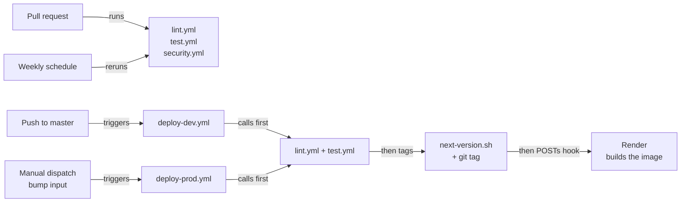

# CI/CD

*The five GitHub Actions workflows: what triggers each one, what every step does, and what this
pipeline does not do yet.*

## Pipeline overview

Two tag lines, one script. Dev deploys tag `vX.Y.(Z+1)-dev.N`; prod deploys tag `vX.Y.Z`.

| Workflow | Trigger | Environment | Ends with |
|---|---|---|---|
| `lint.yml` | push to `master`, PR, `workflow_call` | none | pre-commit green |
| `test.yml` | push to `master`, PR, `workflow_call` | none | pytest green, coverage artifact |
| `security.yml` | push to `master`, PR, weekly | none | bandit, pip-audit, deploy check green |
| `deploy-dev.yml` | push to `master` | `development` | tag pushed, Render dev hook called |
| `deploy-prod.yml` | manual (`workflow_dispatch`) | `production` (reviewer) | tag pushed, Render prod hook called |

Both deploy workflows call `lint.yml` and `test.yml` as reusable workflows (`workflow_call`), so
one file still defines what "passes" means. CI builds and pushes no image: Render builds the
Docker image from the repo on each deploy-hook call.

## `lint.yml`

Triggers: push to `master`, every pull request, and `workflow_call` (so the deploy workflows can
require it).

1. **Checkout**: clones the repo at the triggering commit.
2. **Install uv** (`astral-sh/setup-uv@v10.1.0`). Installs `uv` itself and restores its
   dependency cache, keyed on `uv.lock`. `python-version: "3.13"` is pinned (same in
   `security.yml`): unpinned, `uv` picks the newest CPython, and `psycopg-binary` has no wheel for
   3.15, so `uv sync --locked` fails.
3. **Install dependencies**: `uv sync --locked --all-groups`. `--locked` fails the job outright
   if `uv.lock` doesn't match `pyproject.toml`, rather than silently re-resolving.
4. **Cache pre-commit hook environments**: restores `~/.cache/pre-commit`, keyed on
   `.pre-commit-config.yaml`'s hash, so the hook environments aren't rebuilt every run.
5. **Run pre-commit**: `uv run pre-commit run --all-files --show-diff-on-failure`. The exact same
   command and config the local git hook runs: Ruff check, Ruff format, then the four file-hygiene
   hooks. `--show-diff-on-failure` prints the diff, since there's no interactive terminal here.

## `test.yml`

Triggers: same as `lint.yml`. Matrix: Python 3.13 and 3.14, `fail-fast: false` so one version
failing doesn't hide the other's result.

1. **Checkout**
2. **Install uv**: same as `lint.yml`, plus `python-version: ${{ matrix.python-version }}` so
   `uv` provisions that specific interpreter for the job.
3. **Install dependencies**: `uv sync --locked --all-groups`.
4. **Run tests**: `uv run pytest --cov --cov-report=xml --cov-report=html --cov-report=term`. No
   Postgres service container yet. See "What's missing" below.
5. **Upload coverage report**: one artifact per Python version, kept 14 days. `if: always()` so a
   failing run still uploads the report that shows why.

## `security.yml`

Triggers: push to `master`, every pull request, and a weekly schedule (Monday 06:00 UTC). A new
CVE needs no code change on this repo's side to matter, so `pip-audit` reruns regardless of
activity.

1. **Checkout**
2. **Install uv**
3. **Install dependencies**
4. **Bandit**: `uv run bandit -qr . -c pyproject.toml`. The `-c` is required, or bandit ignores
   `[tool.bandit]` entirely and crawls `.venv`'s thousands of files instead of the real source.
5. **pip-audit**: checks every locked dependency against known vulnerability databases.
6. **Django deploy check**: `manage.py check --deploy --tag security --fail-level WARNING`, with
   `DJANGO_SETTINGS_MODULE=pykaraoke.settings.prod` and throwaway env vars (not real secrets. Just
   values that satisfy the checks' length/entropy/non-empty requirements). The settings module must
   be named explicitly: `manage.py` defaults to `settings.dev`, which has `DEBUG=True` and no
   HTTPS settings, so the check would fail on `security.W004`, `W008`, `W012`, `W016` and `W018`.
   `make audit` runs the same check against dev and tolerates those warnings. Scoped to the `security` tag because nothing configures
   a real SMTP backend yet; the unscoped `--deploy` check would fail on `mail.E001` regardless of
   environment.

## `deploy-dev.yml`

Triggers: push to `master`. Every merge is a dev deploy. Concurrency group `deploy-dev`, no
`cancel-in-progress`: a half-cancelled deploy is worse than a queued one, and queued merges each
get their own tag.

1. **`lint` / `test`**: reusable-workflow calls. The `deploy` job `needs` both, so a red check
   blocks the tag and the hook.
2. **Checkout** with `fetch-depth: 0`. The tag script reads every existing tag; without them
   the script falls back to `0.0.0` and hands out `v0.0.1-dev.1` again.
3. **Compute next dev tag**: `.github/scripts/next-version.sh dev`. The script's output is
   assigned to a variable first, so a script failure fails the step instead of writing an empty
   tag.
4. **Tag the commit**: a lightweight tag on `$GITHUB_SHA`, pushed to `origin`. Needs
   `contents: write`, granted to this job only.
5. **Trigger the Render dev deploy**: `curl -fsS -X POST` on the `RENDER_DEPLOY_HOOK_DEV` secret
   with `&ref=<sha>`. The `ref` pins Render's build to the tagged commit, so a later push cannot
   slip in between the tag and the build.

The job runs in environment `development`. Render **Auto-Deploy must be OFF** on the service, or
every push builds twice and the second build is untagged.

## `deploy-prod.yml`

Triggers: manual only. Input `bump` (`patch`, `minor`, `major`; default `patch`). Production never
deploys from a push. Concurrency group `deploy-prod`, no `cancel-in-progress`.

1. **`lint` / `test`**: same reusable calls as dev.
2. **Reviewer gate**: the job runs in environment `production`, which holds it until a required
   reviewer approves. The reviewer is configured in **Settings → Environments**, not in YAML.
3. **Refuse to run off master**: exits 1 if `github.ref` is not `refs/heads/master`. Dispatching
   from a branch would tag unreviewed code.
4. **Compute next prod tag**: `next-version.sh <bump>`, same assign-first pattern.
5. **Tag the commit**: `vX.Y.Z`, lightweight, pushed to `origin`.
6. **Trigger the Render prod deploy**: `RENDER_DEPLOY_HOOK_PROD` with `&ref=<sha>`.

## Version tags

`.github/scripts/next-version.sh` reads git tags only. No file in the repo stores a version.

| Mode | Result | Example, latest prod tag `v1.4.2` |
|---|---|---|
| `dev` | `vX.Y.(Z+1)-dev.N`, N counts up per base version | `v1.4.3-dev.1`, then `v1.4.3-dev.2` |
| `patch` | bumps Z of the latest prod tag | `v1.4.3` |
| `minor` | bumps Y, resets Z | `v1.5.0` |
| `major` | bumps X, resets Y and Z | `v2.0.0` |

Dev tags never count as the latest prod tag. Delete a prod tag by hand and the next run reuses
its number, so tags are never deleted.

`tests/scripts/test_next_version.sh` covers the script with 12 cases:
`bash tests/scripts/test_next_version.sh`. It is **not** wired into `make check` or CI yet.

## What's missing

- **No Postgres service container in `test.yml`.** `DATABASE_URL` is blank (SQLite fallback) and
  there are zero models until Milestone 2; the container arrives with the first real migration.
- **`test_next_version.sh` is not run by CI or `make check`.** A change to `next-version.sh` is
  only verified if someone runs it by hand.
- **Reviewer on the `production` environment is not verified.** The gate is a manual step in
  **Settings → Environments**. Nothing in this repo enforces it. TODO(verify): confirm it is set.
- **Branch protection on `master` is not configured.** The deploy workflows gate on
  `needs: [lint, test]`, but a PR could still merge into `master` without lint, test, or security
  passing unless required status checks are turned on.
- **Render free plan limits.** No pre-deploy command, so `docker-entrypoint.sh` runs `migrate` at
  start. The service spins down after 15 minutes idle, and the disk is ephemeral: SQLite resets on
  every deploy and spin-down. Accepted for now, not for real data.
- **No dependency-update automation.** `pip-audit` detects known vulnerabilities; nothing (yet)
  opens a PR to fix them. No Dependabot or Renovate configuration exists.
- **No error tracking or uptime monitoring.** The container `HEALTHCHECK` and `GET /health/`
  exist, but nothing external watches them.

## See also

- Workflow anatomy, action versions, and how to verify one before pushing: skill `github-actions`
- Dockerfile, env vars, and the Render deploy flow: skill `devops`
- Secrets and the production gate: [SECURITY.md](SECURITY.md)
- Local equivalent of every CI gate: the `Makefile`
- Fresh-machine setup: [SETUP.md](SETUP.md)
